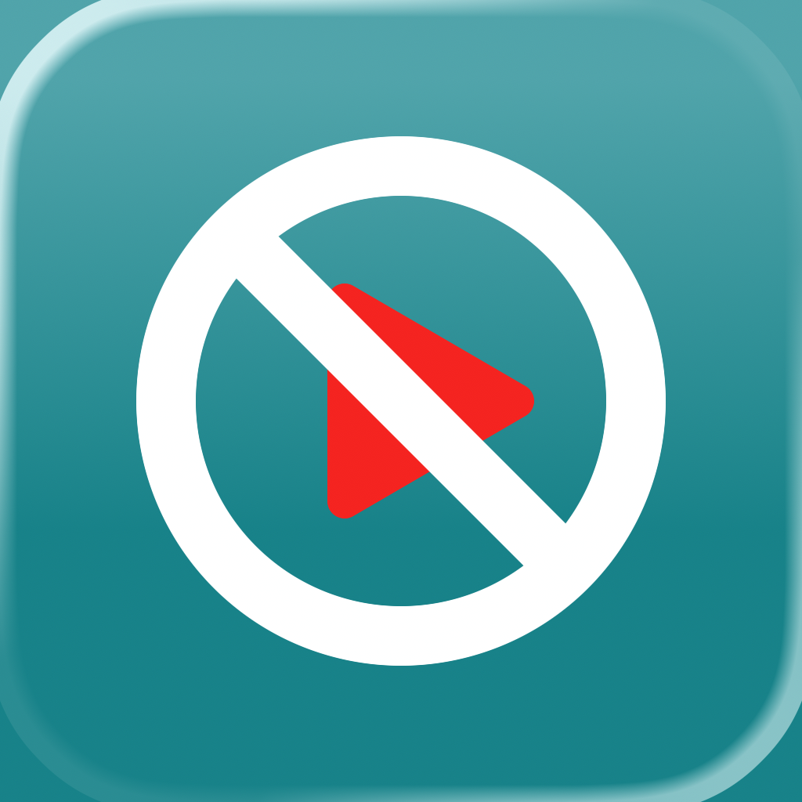

# Test A/B de l’icône — No Shorts 1.2.4 (27)

## Icônes livrées

- Référence C : `Shared (App)/AppIcon.icon`, nom compilé **AppIcon**. Icône principale iOS/iPadOS et macOS.
- Variante E : `Shared (App)/AppIconTeal.icon`, nom exact à sélectionner dans App Store Connect : **AppIconTeal**. Incluse uniquement dans l’app iOS/iPadOS.
- Les documents originaux restent dans `design/icon-concepts/`. La copie intégrée de E retire la surcharge blanche `fill-specializations` du calque `nosign` : dans Xcode 27, cette surcharge remplissait le cercle et masquait le symbole. Le SVG conserve déjà son contour blanc. Le dessin n’est pas changé.
- L’ancien `AppIcon.appiconset` est conservé dans `design/legacy-icon/`, hors compilation.
- Les cinq PNG `icon-{48,96,128,256,512}.png` de l’extension sont exportés depuis C. Les `toolbar-icon-*` restent inchangés.

## Intégration et compatibilité

La voie retenue est l’intégration directe des documents `.icon`. Le compilateur du Xcode installé (27.0, 27A266a) accepte `--alternate-app-icon AppIconTeal` et produit les entrées principales/alternatives dans les dictionnaires iPhone et iPad de `Info.plist`.

Réglages des deux configurations de l’app iOS :

```text
ASSETCATALOG_COMPILER_APPICON_NAME = AppIcon
ASSETCATALOG_COMPILER_ALTERNATE_APPICON_NAMES = AppIconTeal
ASSETCATALOG_COMPILER_INCLUDE_ALL_APPICON_ASSETS = YES
IPHONEOS_DEPLOYMENT_TARGET = 15.0
```

Sur macOS, seule C est compilée ; le minimum macOS est 12.0, approuvé pour cette version. Les quatre cibles conservent la version 1.2.4 et passent au build 27.

Apple indique que Xcode génère automatiquement les images adaptées aux systèmes antérieurs selon le minimum de déploiement : [Icon Composer dans Xcode](https://developer.apple.com/documentation/xcode/creating-your-app-icon-using-icon-composer). La compilation et l’inspection des bitmaps permettent de vérifier les ressources produites ; elles ne remplacent pas un essai sur un appareil sous chaque ancienne version d’iOS.

Aucun appel à `setAlternateIconName` ni nouveau réglage utilisateur : Apple attribue l’icône de la variante lors du téléchargement depuis le traitement PPO.

## Créer le test une fois 1.2.4 approuvée et disponible

PPO concerne iOS/iPadOS, pas macOS. Le binaire actuellement disponible sur l’App Store doit déjà contenir l’icône alternative ; le test E ne peut donc pas démarrer sur 1.2.3.

1. Ouvrir cette app dans App Store Connect, puis **Fonctionnalités → Product Page Optimization** (Optimisation de la page produit).
2. Créer le test `Icon C vs E — 1.2.4`, avec **une variante**.
3. Affecter **50 % du trafic** à la variante : 50 % verront C, 50 % E.
4. Conserver toutes les localisations actives pour maximiser le volume : ar-SA, cs, de-DE, en-US, es-ES, es-MX, fr-FR, it, ko, pt-BR, ru, vi, zh-Hans et zh-Hant. Vérifier cette liste au lancement.
5. Dans le traitement, onglet **App Icon**, choisir **Change**, puis **AppIconTeal**. Garder les captures et aperçus identiques à la référence.
6. Vérifier le traitement et cliquer sur **Démarrer le test**. Si App Store Connect demande une vérification, choisir **Ajouter pour vérification**, puis **Envoyer pour vérification** en conservant uniquement ce test dans la soumission. Le test démarre après l’approbation Apple. Pour C/E le 3 octobre 2026, l’interface a exigé cette vérification malgré la présence de `AppIconTeal` dans le build publié ; la soumission a été effectuée.

Sources Apple : [vue d’ensemble PPO](https://developer.apple.com/help/app-store-connect/create-product-page-optimization-tests/overview-of-product-page-optimization), [création d’un test](https://developer.apple.com/help/app-store-connect/create-product-page-optimization-tests/create-a-test), [configuration des traitements et icônes](https://developer.apple.com/help/app-store-connect/create-product-page-optimization-tests/configure-test-treatments).

Le [processus de lancement Apple](https://developer.apple.com/help/app-store-connect/create-product-page-optimization-tests/run-a-test) décrit aussi la soumission des traitements lorsque l’interface demande une vérification. Le passage automatique à l’état Running après approbation est décrit dans la [présentation Apple de PPO](https://developer.apple.com/videos/play/tech-talks/10888/).

## Durée et décision

Prévoir initialement **14 à 28 jours**, en couvrant au moins deux semaines complètes. Cette durée est une recommandation de planification, pas une garantie de puissance statistique : utiliser l’estimation de durée d’Apple et prolonger si le trafic est insuffisant, dans la limite Apple de **90 jours**.

Comparer le taux de conversion avec la référence C, l’amélioration relative estimée et le niveau de confiance affichés par Apple. Retenir E si elle est classée **Performing Better** avec un niveau de confiance d’au moins **90 %**, un gain de conversion positif et un volume suffisant. Si le résultat reste indécis, conserver C ; ne pas désigner un gagnant à partir d’un simple écart de pourcentage. Éviter de changer les captures, le prix ou de publier une autre version pendant le test.

Source : [résultats et niveau de confiance PPO](https://developer.apple.com/help/app-store-connect-analytics/acquisition/product-page-optimization).

## Si E gagne

Dans une version suivante, remplacer le contenu de `Shared (App)/AppIcon.icon` par E corrigée en gardant le nom principal **AppIcon**, puis régénérer les PNG de l’extension. Compiler et contrôler les rendus, les anciennes versions d’iOS et les deux plateformes avant publication. Le remplacement définitif de l’icône principale exige une nouvelle version du binaire : [présentation Apple de PPO](https://developer.apple.com/videos/play/tech-talks/10888/).

## Vérification du build

Archives Release iOS et macOS et exports App Store Connect réussis avec Xcode 27.0 (27A266a). Aucun avertissement lié aux icônes ; seul l’avertissement habituel d’extraction App Intents sans dépendance AppIntents apparaît pour les cibles.

Dans le `Assets.car` de l’IPA exporté, **chacun** des noms `AppIcon` et `AppIconTeal` possède six images 1024 × 1024 (iPhone/iPad, apparences par défaut/sombre/teintée), trois `IconImageStack` et deux `MultiSized Image`. Une réduction du catalogue avec `assetutil --deployment-target 15.0 --idiom phone --scale 3` conserve les bitmaps 1024 et l’entrée multi-tailles de chaque icône. Les dictionnaires iPhone et iPad de `Info.plist` déclarent tous deux `AppIconTeal` comme alternative.

Les PNG ci-dessous sont **extraits des images aplaties stockées dans le catalogue de l’IPA final**, via une lecture locale de CoreUI ; ils ne proviennent pas d’un nouveau rendu des documents source. Ce lecteur n’est pas inclus dans l’app.

| Référence C | Variante E corrigée |
| --- | --- |
|  |  |

Le [rapport brut `assetutil`](compiled-icons-1.2.4-27/asset-report.json) contient aussi le SHA-256 du catalogue exporté et le résultat de la réduction iOS 15.

Signatures de l’IPA et des bundles macOS vérifiées (`codesign --verify --deep --strict`), signature du paquet macOS vérifiée (`pkgutil --check-signature`). App et extension contiennent toutes la version **1.2.4 (27)**. Le script `content.js` embarqué correspond au correctif du dossier de travail. Le binaire Mac contient arm64 et x86_64.

Couverture du correctif Shorts : vérification Safari 27 connectée à YouTube en largeur desktop et 390 px, puis site `m.youtube.com` avec agent utilisateur iPhone et navigation SPA ; tests DOM du script complet sur les deux hôtes, dont conservation des résultats ordinaires/mélangés et chargement des réglages persistés. Les vérifications Safari utilisaient l’injection du correctif dans Web Inspector. Aucun essai de cette IPA sur appareil physique iOS 15–25 ; la preuve des replis couvre les ressources compilées, pas leur affichage sur chaque OS.


## Statut de publication vérifié le 2 octobre 2026

Les deux builds App Store **1.2.4 (27)** ont été envoyés avec Helm CLI, traités et sélectionnés. Les deux versions et soumissions sont **WAITING_FOR_REVIEW**, avec le mode **AFTER_APPROVAL** : publication automatique après approbation Apple, sans publication effectuée à ce stade. Les notes de version sont vérifiées dans les 14 localisations iOS et les 12 localisations macOS actives.

La soumission finale a été effectuée dans l’interface de Helm : le CLI ne retrouvait pas une soumission pourtant présente dans sa propre liste. Les états finaux ont ensuite été vérifiés indépendamment avec le CLI. Les deux nouvelles questions obligatoires de classification sur les fonctions de réseau social ont été enregistrées à « non » pour ce conteneur de réglages, qui ouvre YouTube dans Safari. La classification reste 4+.

Le [relevé des versions et soumissions](compiled-icons-1.2.4-27/release-status.json) conserve les identifiants exacts. Le test PPO n’est **pas démarré** : il attend que 1.2.4 iOS soit disponible sur l’App Store. Aucun commit ni push effectué ; les changements antérieurs du dossier de travail ont été préservés.

## Publication et tentative PPO du 3 octobre 2026

Les versions **iOS et macOS 1.2.4 (27)** sont maintenant **READY_FOR_SALE**, vérifiées avec Helm CLI et dans App Store Connect via Chrome connecté au compte Guillaume Claverie. Les builds sélectionnés sont toujours `33cd60eb-23ad-405e-98aa-6f97ce31cb9f` (iOS) et `612b3824-c830-4e2c-9e8c-9886473f2602` (macOS).

Le formulaire du test `Icon C vs E — 1.2.4` a été préparé avec une variante, 50 % du trafic et les 14 localisations listées ci-dessus. Apple refuse sa création : « Vous devez arrêter le test actif avant de pouvoir en créer un nouveau. » Aucun nouveau test n’a donc été créé à ce stade.

Le test actif est [Clarity — nouvelle charte — 2026-09](https://appstoreconnect.apple.com/apps/6502996298/distribution/optimization/2f17f6bd-95f9-444a-81eb-e9b06ad90c97), lancé le 7 septembre 2026 et affiché « En cours d’exécution (27 jours) ». Son arrêt attend le choix de l’utilisateur.

Relevé des [analyses Clarity](https://appstoreconnect.apple.com/apps/6502996298/analytics/acquisition/product-pages/optimization/2f17f6bd-95f9-444a-81eb-e9b06ad90c97) avant tout arrêt :

| Page | Impressions uniques | Conversion | Amélioration | Taux de fiabilité affiché |
| --- | ---: | ---: | ---: | ---: |
| Page produit d’origine | 1 994 | 3,53 % | — | — |
| Clair — bénéfice et preuve — iPhone | 2 009 | 3,29 % | −6,71 % | 0,4 % |

Apple affiche « Collecte des données en cours » ; ce relevé ne permet pas de désigner un gagnant. [Capture des résultats](compiled-icons-1.2.4-27/clarity-results-2026-10-03.jpg).

### Arrêt de Clarity et soumission de C/E

Après accord explicite de l’utilisateur, **Clarity a été arrêté le 3 octobre 2026**. Son état est « Arrêté par le développeur ». Le traitement de captures n’a pas été appliqué : la page produit conserve les captures d’origine.

Le nouveau test [Icon C vs E — 1.2.4](https://appstoreconnect.apple.com/apps/6502996298/distribution/optimization/5adaee55-887d-4d00-beee-60a7365a28b5) a été créé et soumis :

- Test : `5adaee55-887d-4d00-beee-60a7365a28b5`.
- Traitement unique **E — TealNoSign** : `cba694db-b16a-48f0-9abd-3d60668c7c03`.
- Référence : **C / AppIcon**, icône actuelle de 1.2.4 ; variante : **E / AppIconTeal**, sélectionnée dans le menu des icônes du build publié et vérifiée visuellement.
- Trafic : **50 %** pour E, **50 %** pour la référence C.
- Les **14 localisations** actives ont été vérifiées cochées dans le test enregistré.
- Captures et aperçus identiques à la page produit d’origine ; seul le choix d’icône diffère.
- [Soumission Apple](https://appstoreconnect.apple.com/apps/6502996298/distribution/reviewsubmissions/details/932bbb7a-cf2a-4210-9617-c721a14b8475) : `932bbb7a-cf2a-4210-9617-c721a14b8475`, contenant uniquement ce test PPO.

**État final vérifié : « En attente de vérification ».** Le test n’est donc pas encore en cours d’exécution. Apple a confirmé « 1 élément envoyé » ; il doit démarrer après l’approbation. Aucun nouveau binaire ni nouvelle version n’a été envoyé pour cette étape ; iOS et macOS 1.2.4 restent disponibles.

La durée d’observation de 14 à 28 jours se compte à partir du démarrage effectif après approbation, et non de la date de soumission.

Preuves : [états des tests](compiled-icons-1.2.4-27/ppo-status-2026-10-03.jpg), [icônes C/E soumises](compiled-icons-1.2.4-27/ppo-icons-2026-10-03.jpg), [relevé de configuration](compiled-icons-1.2.4-27/ppo-status.json). Aucun commit ni push effectué.
